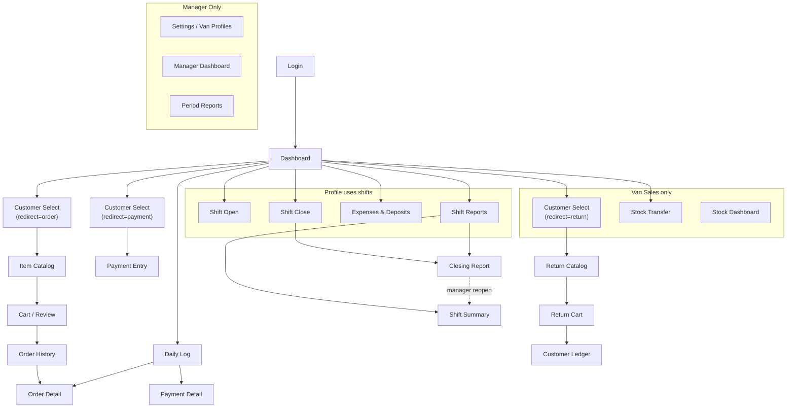

# Van Sale — Product Requirements Document

## 1. App Overview

**Van Sale** is a mobile-first Progressive Web App (PWA) for ERPNext field sales. It serves two kinds of staff from one app, chosen per Van Profile:

- **Van Sales** — drivers who carry stock: take orders, invoice and deliver on the spot, take returns, load the van, collect payments, and run a cash shift with an opening float, expenses and deposits out of the drawer, and a counted-cash closing.
- **Field Sales** — order takers with no van: take orders and collect payments, see read-only stock from a chosen warehouse, and leave invoicing, delivery and returns to the back office. Shifts are optional for them.

Everything is backed by standard ERPNext documents (Sales Order, Sales Invoice, Payment Entry, Stock Entry, Journal Entry). The app adds its own documents only for configuration (Van Profile), shifts (Van Shift Opening / Closing) and drawer cash movements (Van Cash Movement). ERPNext documents are never stamped with a shift: shift totals are attributed by driver and creation time inside the shift's window.

---

## 2. Core Features

- **Profile types** — Each Van Profile is Van Sales or Field Sales. The type drives a capability set (`can_invoice`, `can_deliver`, `can_return`, `can_load_stock`, `can_view_stock`, `uses_shifts`, `requires_open_shift`) that gates screens in the app and is enforced again on every endpoint.
- **Field Order Entry** — Select a customer, browse a price-list-aware catalog with stock from the van (or the Field Sales stock warehouse, read-only), build a cart with editable rates and discounts, and submit Sales Orders into ERPNext.
- **Payment Collection & Allocation** — Collect receivables with Auto-FIFO, Manual, or Advance allocation against outstanding Sales Invoices or Sales Orders.
- **Van Stock Management** (Van Sales) — Real-time stock dashboard for the van warehouse with low-stock alerts, plus a guided Material Transfer from the source warehouse.
- **Invoicing, delivery and returns** (Van Sales) — Invoice an order from the van, deliver pending items later, and issue Credit Notes for returns.
- **Shifts** (POS Awesome style) — Open a shift with a per-mode cash float; record expenses and cash deposits to the office from the drawer, each posted as a Journal Entry; close the shift by counting each payment mode against the expected amount. The closing stores sales, net, taxes, quantity, returns, collections, expenses, deposits, expected cash and the per-mode reconciliation, plus a frozen list of every document it summed.
- **Variance tolerance** — A per-profile tolerance flags a closing as Balanced, Within Tolerance or Exceeds Tolerance. It never blocks a closing; managers see flagged closings on the dashboard and in reports.
- **Shift reports** — A live Shift Summary while the shift is open and a final Closing Report once closed, in the app and as print formats.
- **Manager tools** — Fleet dashboard for today (shift status per staff member, cash on open shifts, alerts for stale shifts, variances, drafts left at close and trading without a shift), period reports with comparison to the previous period, closing any driver's shift, and reopening a closed shift.
- **Stale-shift job** — A daily scheduled task notifies managers of shifts still open from earlier days.

---

## 3. User Stories

| # | Persona | Story |
|---|---------|-------|
| 1 | **Van driver** | *As a van driver, I want to browse my catalog filtered by the customer's price list and instantly see van stock levels so I can place accurate orders on-site without calling the office.* |
| 2 | **Field sales rep** | *As a field rep without a van, I want to take orders and collect payments and see what the warehouse has, without being offered invoicing or delivery actions I am not allowed to do.* |
| 3 | **Driver** | *As a driver collecting a cheque, I want to allocate the payment against the customer's oldest invoices (FIFO) or manually pick specific invoices, so the customer's ledger is updated in real-time.* |
| 4 | **Van driver** | *As a driver returning unsold goods, I want to select items and quantities so a Credit Note is created and the customer's outstanding balance is reduced automatically.* |
| 5 | **Van driver** | *As a driver paying for fuel or handing cash to the office mid-route, I want to record it from the app so my expected cash at closing is right and the accounts are posted without a cashier re-keying it.* |
| 6 | **Driver** | *As a driver ending my shift, I want to count each payment mode against what is expected, see whether I am within tolerance, and see any draft orders I forgot to submit, before the shift closes.* |
| 7 | **Sales Manager** | *As a sales manager, I want to configure each profile (type, warehouses, payment modes, cash accounts, expense rules, variance tolerance) from one screen, so onboarding a new staff member takes minutes.* |
| 8 | **Sales Manager** | *As a sales manager, I want to see at a glance who is on shift, how much cash each van holds, which closings were off by more than I tolerate, and which shifts were never closed, and to close or reopen a shift myself when needed.* |

---

## 4. User Roles (RBAC)

| Role | Access Level |
|------|-------------|
| **System Manager** | Full admin — CRUD on all doctypes, all API endpoints, can delete records. |
| **Sales Manager** | Operations manager — manage Van Profiles, view all reports, close and reopen any shift, cancel cash movements. Cannot delete. |
| **Van Sales Driver** | Field staff (both profile types) — the role is assigned automatically to users on an active Van Profile. Holds read-only DocPerms on Sales Order and on all van_sale documents; every write goes through a whitelisted endpoint that authorizes the caller (own data, own open shift, profile rules) and then bypasses DocPerms. Row-level isolation: own data only. |

---

## 5. Screen Inventory

### 5.1 Login Screen
**Route:** `/login`

| Aspect | Detail |
|--------|--------|
| **Purpose** | Authenticate the user against ERPNext credentials and bootstrap the session (user info, driver config, roles). |
| **Key Elements** | App branding headline · Feature highlight cards (Orders, Payments, Profiles) · Username input · Password input · "Sign in" button · Error message banner |
| **Functionality** | `POST` to Frappe login API → on success, store `UserSession` in Pinia (includes `driver_config`, `is_manager`, `is_driver`) and redirect to Dashboard. On failure, show inline error. |
| **Navigation** | → **Dashboard** (on success). Authenticated users hitting `/login` are auto-redirected to Dashboard. |

---

### 5.2 Dashboard
**Route:** `/` (home)

| Aspect | Detail |
|--------|--------|
| **Purpose** | Central hub showing today's KPIs, the state of the shift, and one-tap access to every workflow the profile allows. |
| **Key Elements** | Setup warning banner (if no profile) · Shift notice (unclosed shift from an earlier day, or "open your shift" when the profile requires one) · **Quick Actions grid** gated by capabilities (New Order, Payment, Ledger; Load Stock / Return for Van Sales; Open Shift / Close Shift, Cash Out, Shift Reports when the profile uses shifts) · **This shift so far** tiles on an open shift (sales, collected, cash in hand, pending drafts) · **Today's Performance** cards · **Recent Activity** list · Manager dashboard for managers (see 5.21) |
| **Functionality** | On mount: parallel fetch `recentOrders()`, `getDailySummary()` and, when the profile uses shifts, `getActiveShift()`; then `getShiftSummary()` for an open, non-stale shift. Actions that need a shift send the driver to open or close one first. |
| **Navigation** | → Customer Select (New Order / Payment / Return / Ledger) · → Stock Transfer · → Shift Open / Close · → Expenses & Deposits · → Shift Reports · → Order Detail · → Daily Log |

---

### 5.3 Customer Select
**Route:** `/customers`

| Aspect | Detail |
|--------|--------|
| **Purpose** | Search and pick a customer before entering the order, payment, ledger, or return workflow. Acts as a routing gateway. |
| **Key Elements** | Back button · Search input (debounced 300ms) · Customer list (name, ID, territory badge) · Loading skeleton · "Current Action" info card explaining the downstream flow |
| **Functionality** | Fetches customers via `searchCustomers(txt)` on mount and on search change. On selection, stores customer in Pinia and routes based on `redirect` query param: `order` → Item Catalog, `payment` → Payment Entry, `ledger` → Customer Ledger, `return` → Return Catalog. |
| **Navigation** | → Item Catalog · → Payment Entry · → Customer Ledger · → Return Catalog · ← Back (previous screen) |

---

### 5.4 Item Catalog
**Route:** `/items`

| Aspect | Detail |
|--------|--------|
| **Purpose** | Browse the product catalog, see real-time van stock and prices, and add items to the order cart. |
| **Key Elements** | Back button · Sticky search bar with icon · Item list rows (name, code, price, stock badge — Out of Stock / Low / Available) · Per-item quantity stepper (+/−) · **Floating cart summary bar** (total + "Checkout (N)" button) |
| **Functionality** | Loads items via `listItems(search, customer)` — returns items with `price_list_rate` and `actual_qty` from the van warehouse. Debounced search (300ms). Add button is disabled for out-of-stock items. Cart state is managed in Pinia (`addToCart`, `updateQty`). Resumes existing draft order items if `currentOrderName` is set. |
| **Navigation** | → Cart View (via floating bar) · ← Customer Select |

---

### 5.5 Cart / Review Order
**Route:** `/cart`

| Aspect | Detail |
|--------|--------|
| **Purpose** | Review, adjust quantities and prices, and confirm the order before submission. |
| **Key Elements** | Customer info card · Item list with quantity stepper (+/−) and editable price chip · Subtotal / Tax / Grand Total breakdown · "Clear All" button · **Sticky "Confirm Order"** button · **Edit Price modal** (bottom sheet with override input and Apply/Cancel) |
| **Functionality** | Tapping the price chip opens a bottom-sheet modal to override the unit rate (`updateRate`). On confirm: builds `itemsPayload`, calls `createSalesOrder()` or `updateSalesOrder()` (for existing drafts). On success, clears cart and navigates to History. Tax is pulled from the existing order detail if available. |
| **Navigation** | → History (on submit) · → Item Catalog (Browse Catalog button) · ← Back |

---

### 5.6 Order History
**Route:** `/history`

| Aspect | Detail |
|--------|--------|
| **Purpose** | List recently created orders for quick review and follow-up. |
| **Key Elements** | "New Order" button · Refresh button · Order cards (customer name, order ID, date, status pill, grand total) · Empty state · Loading skeleton |
| **Functionality** | Fetches `recentOrders(user)` on mount. Each card is tappable → Order Detail. |
| **Navigation** | → Order Detail · → Customer Select (New Order) |

---

### 5.7 Order Detail
**Route:** `/orders/:name`

| Aspect | Detail |
|--------|--------|
| **Purpose** | Inspect a specific Sales Order — line items, totals, status — and perform actions (submit, edit, print). |
| **Key Elements** | Order header (ID, customer, date, status pill, docstatus pill) · Grand Total · Company & Price List info · Items table (name, code, UOM, rate, qty, amount, delivery date) · **Action buttons**: Submit Order (draft only), Edit Items (draft), Add Items (draft), Print Receipt (submitted), Open in ERPNext, Reload |
| **Functionality** | Fetches `getSalesOrder(name)`. Submit calls `submitSalesOrder()` then reloads. Edit Items pre-loads cart from order items and navigates to Cart. Add Items navigates to Item Catalog. Print Receipt calls `downloadPdf('Sales Order', name)`. Open in ERPNext opens `/app/sales-order/:name` in a new tab. |
| **Navigation** | → Cart (Edit Items) · → Item Catalog (Add Items) · → ERPNext desk (external) · ← Back |

---

### 5.8 Payment Entry
**Route:** `/payment`

| Aspect | Detail |
|--------|--------|
| **Purpose** | Create a Payment Entry against a customer — the core receivable collection workflow. |
| **Key Elements** | Customer card (with Change button) · **Customer Summary** banner (outstanding balance, last invoice, last payment) · Mode of Payment dropdown · Paid Amount input · **Allocation Type** toggle (Auto FIFO / Manual / Advance) · Outstanding Invoices list with checkboxes and editable allocation amounts · Invoice search (manual mode) · Sales Order list with radio buttons (advance mode) · Unallocated amount indicator · **Sticky "Confirm Payment"** button |
| **Functionality** | On mount: fetches `getPaymentModes()`, `getOutstandingInvoices()`, `getSalesOrders()`, `getCustomerSummary()`. **Auto mode**: entering an amount triggers FIFO allocation across invoices sorted by posting date. **Manual mode**: tap invoices to select, edit allocation per invoice, paid amount auto-sums. **Advance mode**: optionally link to a Sales Order or leave unlinked. Submit calls `createPaymentEntry(customer, mode, amount, references, salesOrder)`. |
| **Navigation** | → Customer Select (Change customer) · ← Back (on success or cancel) |

---

### 5.9 Payment Detail
**Route:** `/payment-detail/:name`

| Aspect | Detail |
|--------|--------|
| **Purpose** | Read-only view of a submitted Payment Entry — amount, mode, allocation references. |
| **Key Elements** | Customer name + status badge · Date + Mode grid · Amount Paid (large) · "Allocated To" list (reference doctype, name, allocated amount) · Print Receipt button |
| **Functionality** | Fetches `getPaymentEntry(name)`. Print Receipt calls `downloadPdf('Payment Entry', name)`. |
| **Navigation** | ← Back |

---

### 5.10 Customer Ledger
**Route:** `/ledger`

| Aspect | Detail |
|--------|--------|
| **Purpose** | Review a customer's financial history — invoiced amounts, receipts, and running balance over a configurable period. |
| **Key Elements** | Customer selector (with Change) · Period dropdown (Last Week / Month / 3 Months / 6 Months) · Opening Balance card · Invoiced vs. Received summary cards · Transaction list (icon per type, description, date, voucher number, debit/credit amount, running balance) · **Outstanding Balance** gradient card at bottom |
| **Functionality** | Calls `getCustomerLedger(customer, from, to)` which returns `{ opening_balance, entries[] }`. Computes running balance per entry. Debit = Invoice (red), Credit = Payment (green). Period change triggers re-fetch via watcher. |
| **Navigation** | → Customer Select (Change customer) · ← Back |

---

### 5.11 Daily Log
**Route:** `/daily-log/:type` (type = `orders` | `payments`)

| Aspect | Detail |
|--------|--------|
| **Purpose** | View all of today's Sales Orders or Payment Entries in one place, with totals and mode-of-payment breakdown. |
| **Key Elements** | Back button · **Payment Summary card** (total collection + per-mode breakdown grid — payments only) · Transaction cards (customer/party name, ID, status pill, mode-of-payment tag, date, amount) · Empty state |
| **Functionality** | Calls `getDailyLog(doctype)`. Tapping a card navigates to Order Detail or Payment Detail depending on type. Status badges are color-coded (Draft, Submitted, Paid, etc.). |
| **Navigation** | → Order Detail (orders) · → Payment Detail (payments) · ← Dashboard |

---

### 5.12 Driver Stock Dashboard
**Route:** `/stock` (requires driver config)

| Aspect | Detail |
|--------|--------|
| **Purpose** | Live view of all items in the driver's assigned van warehouse with low-stock alerts. |
| **Key Elements** | Refresh button · Offline snapshot warning banner · Error banner · No-profile message · **Summary grid** (Items count, Low Stock count, Available Qty, Reserved Qty) · Source Warehouse + Low Threshold info · Search/filter input · Stock item cards (name, code, UOM, Available / Reserved / Projected quantities, "Low" badge) |
| **Functionality** | Calls `getDriverStockDashboard(forceRefresh)`. Caches response in `localStorage` — if API fails, falls back to cached snapshot with warning. Search filters items client-side by name or code. Requires `driverConfig` (route guard redirects to Dashboard with setup prompt if missing). |
| **Navigation** | ← Dashboard (via nav) |

---

### 5.13 Stock Transfer (Load Van)
**Route:** `/transfer` (requires driver config)

| Aspect | Detail |
|--------|--------|
| **Purpose** | Build and submit a Material Transfer (Stock Entry) from the main warehouse to the van warehouse. |
| **Key Elements** | From/To warehouse display · Optional remarks textarea · Search input for source items · Source item results (name, code, UOM, available qty, batch/serial indicators, Add button) · **Transfer Lines** list (qty input, batch dropdown, serial number textarea, Remove button, available qty) · **Sticky footer** (line count + Submit Transfer button) |
| **Functionality** | Searches source warehouse items via `searchTransferItems(search)`. Adding an item calls `getTransferItemDetail(itemCode)` to get batch/serial info. Validates: qty > 0, qty ≤ available, batch selected if required, serial count matches qty. Submit calls `createStockTransfer(lines, remarks)` which creates a Stock Entry (Material Transfer). On success, clears lines and reloads source items. |
| **Navigation** | ← Back |

---

### 5.14 Return Catalog
**Route:** `/return-items`

| Aspect | Detail |
|--------|--------|
| **Purpose** | Select items and quantities to return from a customer. |
| **Key Elements** | Back button · Customer name display · Search input · Item cards (name, code, return credit rate, +/− stepper) · **Floating "View Return"** bar (return total + button) |
| **Functionality** | Loads items via `listItems(search, customer)`. Uses separate `returnCart` in Pinia store (`addToReturnCart`, `updateReturnQty`). Price displayed is the credit rate. |
| **Navigation** | → Return Cart (View Return) · ← Customer Select |

---

### 5.15 Return Cart
**Route:** `/return-cart`

| Aspect | Detail |
|--------|--------|
| **Purpose** | Review return quantities and process the credit note. |
| **Key Elements** | Total Credit Issued card · Item count · Item list (name, code, unit price, line total, +/− stepper) · Error banner · **Sticky "Process Return Credit"** button |
| **Functionality** | On submit: maps cart to `{ item_code, qty }[]` and calls `createSalesReturn(customer, items)`. Backend creates a Credit Note. On success, clears return cart and redirects to Customer Ledger to verify the credit. |
| **Navigation** | → Customer Ledger (on success) · ← Return Catalog |

---

### 5.16 Expenses & Deposits (Cash Movements)
**Route:** `/expenses` (profile must use shifts)

| Aspect | Detail |
|--------|--------|
| **Purpose** | Record cash leaving the drawer during an open shift: an **Expense** (fuel, tolls, a repair) or a **Deposit** of cash to the office. Each posts a Journal Entry. |
| **Key Elements** | "No open shift" state with an Open Shift button · Expense / Deposit segmented control (per profile flags) · Amount (with the profile's max per movement) · Expense account select (restricted to the profile's allowed accounts, defaulting to its default expense account) · Paid to / Deposited with · Remarks (required if the profile says so) · Source → target account preview · This-shift list with KPI tiles (expenses, deposited), Journal Entry numbers, and a manager-only Cancel |
| **Functionality** | `getCashMovementContext()` returns the rules, accounts and this shift's movements. `createCashMovement()` requires the caller's own open shift, validates the profile rules server-side (`Van Cash Movement.validate`), freezes the accounts on the document and posts the Journal Entry on submit: Expense = debit expense account / credit drawer; Deposit = debit back-office cash account / credit drawer. The drawer account is the profile's Cash Drawer Account, else the Default Cash Mode's account for the company, else the company default cash account. `cancelCashMovement()` (managers) reverses the Journal Entry, only while the shift is still open. |
| **Navigation** | → Shift Open (if none) · ← Dashboard |

---

### 5.17 Shift Open
**Route:** `/shift/open` (profile must use shifts)

| Aspect | Detail |
|--------|--------|
| **Purpose** | Start the shift with an opening cash float per payment mode. |
| **Functionality** | `openShift(balance_details, notes)` creates and submits a **Van Shift Opening** with `period_start = now`. Refused while the driver has any open shift, including one from an earlier day ("stale"), which must be closed first. Only the profile's allowed payment modes are accepted. |

---

### 5.18 Shift Close
**Route:** `/shift/close` (`?opening=` lets a manager close a specific driver's shift)

| Aspect | Detail |
|--------|--------|
| **Purpose** | Reconcile each payment mode and close the shift. |
| **Key Elements** | Stale / closing-on-behalf banner · **Draft orders** warning listing unsubmitted orders made during the shift (links to each) · **Activity before this shift opened** notice (orders / payments on the shift's date created before it opened and claimed by no closing) · KPI tiles (sales with units and tax, collections, opening float, expected cash, expenses, deposits) · Per-mode reconciliation (opening, expected, counted input, difference) · Net variance panel with the tolerance status (Balanced / Within Tolerance / Exceeds Tolerance) · Notes · Sticky Close Shift |
| **Functionality** | `getShiftClosingSummary()` recomputes everything server-side for the shift's window (driver + creation between `period_start` and now): submitted Sales Orders (sales, net, taxes, quantity), Sales Invoices (invoiced / returns), receive Payment Entries (collections per mode), Van Cash Movements linked to the shift (expenses, deposits) and legacy Van Expense Logs by date. Records already summed by another submitted closing are excluded. Expenses and deposits are deducted from the cash mode's expected amount. `closeShift()` stores all totals, the taxes table, the per-mode reconciliation, the variance tolerance and status, the number of drafts left, the frozen `transactions` list and `period_end`, then marks the opening Closed and links it to the closing. A stale shift closes as the day it was opened. Nothing blocks a close: variances and drafts are flagged only. |
| **Navigation** | → Closing Report (on success) · ← Back |

---

### 5.19 Shift Reports
**Routes:** `/shift/reports` (list) · `/shift/summary` (open shift, `?opening=` for managers) · `/shift/closing-report/:name`

| Aspect | Detail |
|--------|--------|
| **Purpose** | The **Shift Summary** is a read-only live snapshot of an open shift (it never closes it). The **Closing Report** is the final report of a closed shift, read from the Van Shift Closing so it reprints identically. |
| **Key Elements** | Header (driver, van, opened, closed / as of, closed by) · KPI tiles · Variance panel with status and tolerance · Sales breakdown (orders, net before tax with units, taxes, invoices, returns, net invoiced) · Taxes on orders by account and rate · Collections by mode · Cash reconciliation · Expenses and deposits with Journal Entry numbers · Items sold / returned · Draft orders (summary) or drafts-left note (closing) · Notes · Print (PDF via the "Van Shift Summary" / "Van Shift Closing Report" print formats) · **Reopen shift** (managers, closing report) |
| **Functionality** | `getShiftSummary()`, `getClosingReport()`, `getShiftClosings()`; `reopenShift(closing)` cancels the closing, puts the opening back to Open with no end time, and is refused while the driver has another open shift. The shift then continues until closed again; the new closing spans from the original opening to the new close. Drivers see only their own shifts; managers see all. |

---

### 5.20 Settings → Van Profiles (Manager Only)
**Routes:** `/settings`, `/van-profiles` (requires manager role)

| Section | Detail |
|---------|--------|
| Identity | Profile name, **Profile type** (Van Sales / Field Sales), company, delivery route (Territory), active flag |
| Warehouses | Van Sales: source warehouse and van warehouse (required, different). Field Sales: an optional read-only stock warehouse |
| Drivers / customers / payments | Assigned staff (role is synced automatically), allowed customer groups, allowed payment modes, default cash mode |
| Operational controls | Daily credit limit, low stock threshold, rate / discount changes, selling without van stock, **Use shifts**, **Require open shift**, **Variance tolerance**, strict stock validation, offline stock dashboard, pricing rules |
| Staff controls (POS-profile style) | **Hide items not in van stock**, **Allow credit sales** (off: every invoice is paid when raised), **Allow returns** + **Return validity (days)**, **Show customer balance**, **Allow creating customers** + **Allow duplicate customer names**, **Staff can close their own shift** (off: managers only), **Blind cash count** (expected amounts hidden from the driver at close) |
| Cash movements | Allow expenses, allow deposits, cash drawer account, back office cash account, max amount per movement, require remarks, **staff can cancel their own** (while the shift is open), allowed expense accounts, default expense account, cost center |
| Pricing, print, accounting | Price list, currency, taxes template, discount basis, **Max discount %**, **Use the customer's price list**, **Allow zero rated items**, print format, letter head, income / expense / write-off accounts |

Saving goes through `saveVanProfile()`; the profile controller validates the type-specific rules and clears the driver config cache.

Every control is enforced server-side in the endpoint it concerns (`sales.py`, `shift.py`, `cash_movement.py`) and mirrored in the app through `capabilities` (`utils._capabilities`): `can_credit_sale`, `can_return`, `can_create_customer`, `can_close_shift`, `can_cancel_cash_movement`, `shows_customer_balance`, `blind_shift_close`. Managers are never bound by them.

---

### 5.21 Manager Dashboard & Period Reports (Manager Only)
**Routes:** `/` (dashboard component) · `/reports`

| Aspect | Detail |
|--------|--------|
| **Dashboard** | Today across the fleet: open / closed shift counts, cash on open shifts, one card per staff member (shift status: open, closed, stale, none / "No shifts" for profiles without them; sales, collected, cash in hand or variance with its tolerance status, drafts left) with Close Shift, and an **alerts** list: stale shifts (with a close link), variances beyond tolerance, drafts left at close, trading without an open shift. |
| **Period reports** | Any date range, optionally one driver or profile, compared with the preceding period of the same length: totals and comparison rows (sales, orders, returns, collections, expenses, deposits, net cash, variance), daily trend, per-driver split (incl. flagged shifts and drafts), items and item groups, customers, collections by mode, expenses by account, and the closed shifts of the period with their variance status. |
| **Functionality** | `getManagerDashboard()`, `getPeriodReport()`, `getFleet()`. Attribution is by the user who created each document, the same rule the closing uses. |

---

### 5.22 App Shell (Global Navigation)
**Component:** `AppShell.vue` (wraps all authenticated views)

| Aspect | Detail |
|--------|--------|
| **Purpose** | Persistent navigation frame — top header + bottom tab bar (mobile) / left rail (desktop). |
| **Key Elements** | **Header**: "Van Sales" or "Field Sales" title by profile type, warehouse / user subtitle, online indicator · **Nav tabs**: Home, Activity, Stock (only with `can_view_stock`), Ledger, Settings (managers) · Logout |
| **Functionality** | Tabs and quick actions are gated by the session's `capabilities`; the router redirects a driver away from any route whose `meta.capability` their profile lacks. |

---

## 6. Navigation Flow Diagram

---

## 7. Backend DocTypes

| DocType | Purpose |
|---------|---------|
| `Van Profile` | Configuration per van or field team (modeled after POS Profile): profile type, warehouses, staff, customer groups, payment modes, controls, shift and cash movement settings, pricing and accounting defaults |
| `Van Profile Driver` / `Van Profile Payment Mode` / `Van Profile Customer Group` / `Van Profile Expense Account` | Child tables of Van Profile |
| `Van Shift Opening` | A shift: driver, date, status, `period_start`, opening float per mode (`Van Shift Balance Detail`), and once closed `period_end` and `closing_shift` |
| `Van Shift Closing` | The closing: totals (sales, net, taxes, quantity, returns, collections, expenses, deposits, opening float, expected cash, net difference), variance tolerance and status, drafts left, `Van Shift Closing Tax` rows, `Van Shift Payment Reconciliation` rows, and `Van Shift Transaction` references to every document summed |
| `Van Cash Movement` | Expense or Deposit out of the drawer on an open shift, with frozen source / target accounts and the Journal Entry it posted |
| `Van Expense Log` | Legacy expense entries without accounting; read-only for drivers, still counted in history |
| `Van EOD Report` | Legacy end-of-day record, superseded by shifts |

---

## 8. Backend API Modules (`van_sale/van_sale/`)

| Module | Responsibility |
|--------|---------------|
| `sales.py` | Sales Order CRUD, invoicing, delivery of pending items, returns, daily summary and log |
| `finance.py` | Payment Entry creation, outstanding invoices, customer summary / ledger, payment modes |
| `inventory.py` | Stock dashboard, stock transfer, transfer item search / detail |
| `shift.py` | Open / close / reopen shifts, closing summary, window aggregation (`_compute_closing`), `require_open_shift` |
| `shift_report.py` | Shift summary and closing report builders, closings list, print format data |
| `cash_movement.py` | Cash movement context, create, list, manager cancel |
| `manager_report.py` | Manager dashboard and period reports |
| `tasks.py` | Scheduled jobs: daily stale-shift notification to managers |
| `van_profile.py` | Van Profile CRUD, options and the per-driver config payload |
| `driver.py` | App context (session, driver config, capabilities), setup options |
| `utils.py` | Authorization helpers (`_require_van_user`, `_require_capability`, customer access), capability model, driver config cache |
| `setup.py` | App installation hooks (role creation, permissions) |
